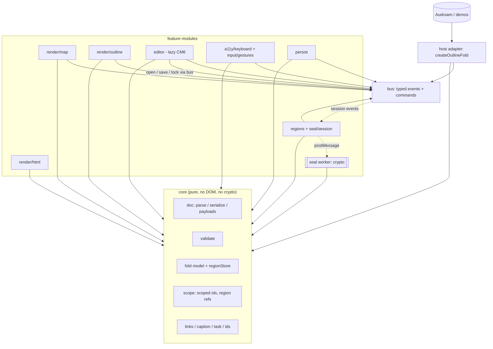

# Spec: outline-fold v1 rebuild (structure, not features)

Status: **draft** · Date: 1 Nov 2026 · Base: `feature/submap-regions-unseal` @ `32d6f8f` (package 0.3.1 + Unreleased P1–P4/R1)

> The brief called the current line 0.2.x. `package.json` is actually at **0.3.1**, with the region/unseal/editor work unreleased on top. Everything here means "0.2.x–0.3.x" when it says "0.x".

## 1. Goals and non-goals

**Goals**
1. Feature parity with 0.x plus the Unreleased branch. No new features. Text-mode folding (§3.8) is only a proposal for Colin to decide.
2. Modular structure. A pure core with no DOM. One typed event and command bus. Renderers, regions/crypto, editor, keyboard/a11y and persistence are separate modules that talk only through the bus and the core model.
3. One host-adapter pattern, so Audroam (and any other host) wires events in one place instead of reaching into `mapView` internals.
4. Split `src/mapView.ts` (6,521 lines, about 34% of `src/`) into the Map renderer plus its gesture, camera, label and region sub-modules.
5. A smaller, intentional public API. Today `src/index.ts` re-exports about 450 symbols, many of them internal constants and helpers.
6. A fast test suite. The default `npm test` runs with no browser, and total suite time must not grow (§5).

**Non-goals**
- No changes to the grammar or file format. `parse`/`serialize` must round-trip every 0.x document byte for byte. `of-seal-v2` stays, and v1 stays decrypt-only.
- No new views, gestures or crypto modes.
- No framework rewrite. The package stays vanilla TS and DOM; React stays an example host only.
- No production MFA. The host still owns key release.

## 2. Feature-parity inventory

Sources: README sections, CHANGELOG, `src/index.ts` exports, and the branch spec `20261101-submap-regions-editor-unseal.md`. Each row gets a v1 module (see §3).

| # | Feature (0.x) | Current files | v1 module |
|---|---|---|---|
| F1 | Grammar v0.2: lean lines, trailer payloads, ids, kinds and flags, tags (`canonTag`/`displayTags`) | parse, serialize, payloads, tagSpelling, types | `core/doc` |
| F2 | Links: `#N` jumps, notes, threads, actions, URL templates, link popover | captionRich, taskChrome, linkTemplates, linkPop | `core/links` + `ui/linkPop` |
| F3 | Rich captions: markdown links, tiny HTML runs, line breaks, tspans | captionRich | `core/caption` |
| F4 | Fold model: `fold-`/`fold+`, `toggleFold`, `setExpandLevel`, fold levels, whole-map levels, count labels | fold, foldLevel, foldLevelMenu (logic) | `core/fold` |
| F5 | Tasks: states, toggling, action firing, task chrome and icons | task, taskChrome, icons | `core/task` + `ui/icons` |
| F6 | Node addressing: persistent ids, `mintNodeId`, auto ids, `cleanIds`/`cleanMarkdown` | nodeAddress, clean | `core/ids` |
| F7 | Validation: `validateDocument`, severities, sealed-branch checks | validate, sealedState | `core/validate` |
| F8 | `toHtml` static render | toHtml | `render/html` |
| F9 | Outline tree: `attachOutlineTree`, keyboard expand level, live announcements | attachOutlineTree | `render/outline` + `a11y` |
| F10 | Map: `createMapView`, auto-pack, scrapbook pack, pills, edges, paint tokens, controls and levels | mapView, mapLabel, svgTextMeasure | `render/map/*` |
| F11 | Map widths: fit/auto/one-line scope, width menu, drag, toasts | mapFit | `render/map/width` (logic in core) |
| F12 | Camera: follow, ensure-visible, fit, easing | mapCamera | `render/map/camera` (pure math) |
| F13 | Gestures: tap/touch guard, swallow, alt-hold menu arbiter (0.2.44), level hold ring, pinch | mapTap, altGesture, mapGesture, foldLevelMenu | `input/gestures` |
| F14 | Node menu: Copy jump, Copy link, focus href (0.2.39) | nodeMenu | `ui/nodeMenu` |
| F15 | Time leaves (0.2.40) | timeLeaf | `render/map/timeLeaf` |
| F16 | Default/cold-start fold seed, lineage height | mapSeed | `core/fold/seed` |
| F17 | Persistence: saved views v2, view prefs, map resume, debounced save, stale check, soft reset | savedView, mapResume | `persist` |
| F18 | Sealed v2: keyring, `sealBranch`/`openSealedBranch`, v1 migration, Argon2 provider, cipher selection, viewers | sealedBranch, sealed, payloads, demoCrypto | `seal` (crypto in a worker) |
| F19 | Seal sessions: state machine, auto-lock, nested "Unlock this branch too?", Remove-seal re-auth | sealSession | `seal/session` |
| F20 | Regions: clouds, `placeRegions`, hulls, mount/unmount, depth cap | mapRegion, regionLayout, mapView | `regions` + `render/map/region` |
| F21 | Scoped ids `regionId:nodeId`, `<r:REGION:N>` resolution | scopedId | `core/scope` |
| F22 | Region fold store, reveal, Outline composition, wipe on lock (R1, FOLD-1..9) | regionFold | `core/fold/regionStore` + `regions` |
| F23 | Host API `on`/`dispatch` | hostApi | `bus` + `host` |
| F24 | Lazy CM6 editor with secure zone (`./editor` export) | editor/, editorLoader | `editor` (lazy) |
| F25 | CSS export `./outline-fold.css` and paint tokens | outline-fold.css | `styles` (same export path) |
| F26 | Keyboard: directional nav, fold keys, focus ownership, selection vs pan | mapView (`mapKeyboard*`, `resolveMapFocus`) | `a11y/keyboard` |
| F27 | Text mode: plain text, font-size A−/A+ buttons, no folding (text folding is only a proposal, §3.8) | editor/ | `editor` |
| F28 | Inline unsealed editors in CM6: green secure-zone block widget, same unlock prompt, nested memory-only editor, save re-seals into the parent payload, nested zones, per-tab unlock and 5-min auto-lock; raw/static views show only `<enc:KEYID>` | editor/ (secure-zone widget), sealSession | `editor/secureZone` via bus → `seal` |

**Export inventory.** About 450 named exports from 33 modules. v1 sorts each one into a group:
- **Public**: types, parse/serialize/validate/toHtml, fold ops, ids, the bus, `createOutlineFold`, renderer factories, seal API, persistence API.
- **Advanced**: `@audroam/outline-fold/internals`. These are layout constants (`CHAR_W`, `PILL_PAD_*`, `WIDTH_*`, `VIEW_*`, `ALT_*`, `LEVEL_*`, `TIME_LEAF_*`) and pure helpers that hosts and tests use today.
- **Compat-only**: kept in `@audroam/outline-fold/compat` for 0.x callers (for example `mapPaintShouldRestoreFocus`, `clearSelectionForMapPan`, `swallowConsumes`).

`scripts/export-inventory.mjs` (phase V0) will produce `docs/specs/v1-export-map.json` and fail the build when an export in 0.x has no v1 home.

## 3. Architecture

### 3.1 Layers


### 3.2 Dependency rules (enforced by `scripts/check-deps.mjs` in CI, no test runner needed)
1. `core/**` imports only `core/**`. It does not use DOM globals, `window`, `localStorage`, timers or `crypto`.
2. `bus` imports only `core` types.
3. Feature modules import `core` and `bus`. They never import each other. For example, the editor reaches the seal module only through bus commands (`open`, `save`, `lock`) and events (`unlock`, `lock`, `error`). Map and Outline talk only through bus events and the shared fold store.
4. Only `host` composes modules. Only `host` and `editor/loader` use dynamic `import()`.
5. Crypto lives only in `seal/worker`. The main thread holds no plaintext key material after `lock`. A non-worker fallback (Node and tests) uses the same `SealPort` interface.
6. The editor package is reached only through `import('./editor')`. A static import of CM6 from anywhere else fails the dep check.
7. There are no module-level mutable singletons. Today `sealedBranch` has `setSealCipher`, `setArgon2Provider` and a global key cache. In v1 these move to instance state created by `createSealService()`.

### 3.3 Core
- `Doc` is an immutable tree plus trailers. `parse(text) → Doc` and `serialize(Doc) → text` round-trip.
- `FoldModel` is one store keyed by `ScopedId` (`nodeId` or `regionId:nodeId`, with `regionId` for a region root). Today's per-node `fold` flags and `createRegionFoldStore` merge into this one store. Writing fold state back into `fold-`/`fold+` happens only in `serialize`, and only for the root document. Region and unlocked-sealed state stays memory-only, as now.
- Pure layout math (auto-pack, measure, camera, width, saved-view selection) moves out of the DOM files into `core/layout`, so jsdom tests can import it without a renderer. `svgTextMeasure` sits behind a `Measurer` interface that has a fixed-width implementation for tests.

### 3.4 Bus
`createBus()` replaces `createHostApi`. It keeps the same `on`/`dispatch` shapes and adds the internal events the renderers need, so Build can wire listeners without patching renderers:
```ts
type OFEvent =
 | { type:'unlock'|'lock'|'save'|'change'|'error'; ... }      // 0.x host events, unchanged
 | { type:'select'; id:ScopedId; view:ViewName }
 | { type:'fold'; id:ScopedId; collapsed:boolean; source:ViewName|'host' }
 | { type:'foldLevel'; scope:ScopedId|'all'; level:ExpandLevel }
 | { type:'task'; id:ScopedId; state:TaskState }
 | { type:'link'; id:ScopedId; target:ResolvedRef }
 | { type:'copy'; id:ScopedId; kind:NodeCopyKind }
 | { type:'width'; id:ScopedId; entry:WidthEntry }
 | { type:'view'; view:ViewName; camera?:CamState };
type OFCommand =
 | { cmd:'open'|'lock'|'reveal'|'focus'; ... }                  // 0.x, unchanged
 | { cmd:'fold'; id:ScopedId; collapsed?:boolean }
 | { cmd:'foldLevel'; scope:ScopedId|'all'; level:ExpandLevel }
 | { cmd:'setDoc'; text:string } | { cmd:'save'; region?:RegionId }
 | { cmd:'editor'; open:boolean } | { cmd:'resetView' };
```
- Events are emitted only after a state change has been committed. If a listener throws, the other listeners still run (same as now).
- Each event carries `source`, so views do not echo each other's changes back.

### 3.5 Renderers
- `render/map` is split into `view.ts` (mount, paint), `pill.ts`, `edges.ts`, `camera.ts`, `width.ts`, `timeLeaf.ts`, `region.ts` and `controls.ts`. Each file stays under about 800 lines. A renderer subscribes to `fold`, `select` and `doc` changes and dispatches commands. It never calls host callbacks directly.
- `render/outline` is `attachOutlineTree` rebuilt on the same store and bus.
- `render/html` is the pure `toHtml` string output.

### 3.6 Regions / unseal / crypto
- `seal/service` holds the keyring, cipher choice and Argon2 provider as instance state. The heavy work (KDF, AEAD) runs in a `seal/worker` reached through a `SealPort`.
- `seal/session` is the existing state machine (`sealed → unlocking → unlocked → saving`, `error`). Its transition table becomes data.
- `regions` handles mount/unmount, `placeRegions`, the region `Doc` instances and wipe-on-lock. It is wired to the fold store by subscribing to `lock` (replaces `bindRegionFoldToSessions`).

### 3.7 Editor (lazy)
`editor/` contains the CM6 views, the secure zone and the A−/A+ font-size buttons (plus the text fold controls only if §3.8 is adopted). It is loaded only by `dispatch({cmd:'editor', open:true})`. The peer dependencies stay optional.

### 3.8 Text mode (corrected 1 Nov 2026)
**Parity:** Text mode is plain text. Its only toolbar controls are the font-size buttons **A− / A+**, which scale the text and are not fold controls. Today's editor has **no folding**.

**Inline unsealed editors (Colin, 1 Nov 2026; this reverses the earlier "Text never unseals" rule):**
- In the CodeMirror editor, a sealed line renders as a **block widget, the green secure zone**. It unlocks through the **same prompt** as Map and Outline (`dispatch({cmd:'open'})` → `seal/session`).
- Once unlocked, the zone hosts a **nested, memory-only CM6 editor** for the inner text. Plaintext never enters the parent document state, undo history or clipboard of the outer editor.
- **Save re-seals** (same kid and mode) into the parent payload, so the main document text only ever holds the `<enc:KEYID>` line.
- **Nested sealed lines** inside an unlocked zone open their own nested zone and editor. The existing rules apply: "Unlock this branch too?" for a key that is already unlocked, and locking a parent locks its children.
- The same **per-tab unlock** and **5-minute idle auto-lock** (`autoLock` in the layout block) apply. On lock, the nested editor is destroyed and its memory wiped.
- A **plain raw or static view** (no CodeMirror, e.g. `toHtml`, a textarea fallback, copy of the main text) still shows **only the `<enc:KEYID>` tag**.

**Proposed, Colin to decide: folding in Text mode.** This is not part of parity and does not ship unless Colin adopts it.
- Fold controls sit at the **right end of each line that has children**, never in the left gutter.
- Show **−** when the line is open and **+N** when it is folded.
- Faint by default (**opacity about 0.25–0.3**), full strength on hover or when the cursor is on that line.
- **30 px** tap target on touch.
- Not selectable (a CM6 widget decoration with `user-select:none`), so copy never picks them up.
- Must look **visually distinct from the A− / A+ font-size buttons**: for example, inline at the end of the line rather than in the toolbar, a different shape and weight, and no button chrome.
- A sealed line (secure-zone widget) gets no fold control.
- If adopted, a click dispatches `{cmd:'fold'}` using the same store and events as Map and Outline.

### 3.9 Keyboard / a11y and persistence
- `a11y` owns focus, roving tabindex, the key maps (fold keys, digits, `*`, Home/End, Esc, directional nav) and the live-region announcements. Each renderer registers a `FocusTarget`.
- `persist` provides `StorageLike` adapters for saved views, view prefs and map resume (v2 keys unchanged). It listens to bus events and writes through a debounce. It does not write to localStorage directly from inside renderers.

## 4. Public API and host adapter
```ts
import { createOutlineFold } from '@audroam/outline-fold';
const of = createOutlineFold({
  text, storage?: StorageLike, seal?: { argon2?, cipher?, port?: SealPort },
  views: { map?: HTMLElement, outline?: HTMLElement, text?: HTMLElement },
  options?: { autoLock?, linkTemplates?, paint?, readOnly? },
});
of.on('save', e => …); of.on('fold', e => …);
await of.dispatch({ cmd:'open', region, passphrase });
of.doc(); of.text(); of.destroy();
```
- Pure entry points stay as named exports: `parse`, `serialize`, `validateDocument`, `toHtml`, fold ops, ids, `scopeId`/`resolveRegionRef`, and all types.
- Renderer factories (`createMapView`, `attachOutlineTree`) stay available for advanced hosts, but they take `{ bus, store }`.
- **One host-adapter pattern.** Each host writes exactly one adapter module that does three things: (a) gets the bus from `createOutlineFold`, (b) maps host events to commands, and (c) maps bus events to host actions such as save, toasts, MFA and navigation. Nothing else in the host imports outline-fold internals.

## 5. Test strategy
- **Default `npm test` = vitest, node environment, core only.** Covers parse/serialize round trips over `examples/` and `tests/vectors`, fold model, scoped ids, validation, the session transition table, layout math, and crypto vectors (with the worker replaced by an in-process port).
- **Renderers in jsdom (`*.dom.test.ts`).** These use the fixed-width `Measurer` with no real layout and no timers (fake timers only), and assert on bus events and DOM structure.
- **Playwright is an optional smoke set** (`npm run test:smoke`) and is not part of `npm test`. It has 6 specs at most: map load and fold, touch tap, alt menu, unlock and cloud (SEAL-2), editor lazy-load and A−/A+, Pages viewer. Settings are `timeout: 10_000`, `expect: 3_000`, chromium plus one touch project, `retries: 0`. Today's 25 e2e specs become unit or jsdom tests or are dropped.
- **Runtime budget, checked in CI:** core under 5 s, jsdom under 15 s, smoke under 60 s. Any single test file over 2 s fails a budget check (vitest `--reporter=json` plus a script). The total must not exceed the current suite time, which phase V0 records as the baseline.
- Per the brief, this doc adds no tests. These are plans for the phases below.

## 6. Migration from 0.x
- **Compat shim** `@audroam/outline-fold/compat` re-exports the 0.x names (`createHostApi`, `createMapView(opts)` old signature, `createRegionFoldStore`, `bindRegionFoldToSessions`, `regionOutlineBridge`, the global `setSealCipher`/`setArgon2Provider`, the constants) as thin wrappers over v1. It is shipped in 1.0 and removed in 2.0. Every wrapper logs `console.warn` once in development builds.
- Storage keys, the file format, `of-seal-v2`, CSS class names and paint tokens stay unchanged, so saved views and resume state carry over.
- **Audroam** moves over in three steps:
  1. Add `audroam/src/outlineFoldAdapter.mjs`, the only file that imports `@audroam/outline-fold`. It first wraps the compat API.
  2. Move each hand-wired listener into the adapter as `of.on(...)` / `dispatch(...)`, one feature at a time behind a flag.
  3. Switch the adapter from compat to `createOutlineFold` and delete the legacy mjs wiring and decrypt code (old P6).

## 7. Phases (S = 1–2 days, M = 3–5 days, L = 1–2 weeks)
| Phase | Work | Size |
|---|---|---|
| V0 | Export inventory script, dep-check script, record test-time baseline, mark 0.x export groups | S |
| V1 | `core/` extraction (doc, fold store with scoped ids, scope, validate, layout math, Measurer) behind the current exports | L |
| V2 | `bus` + `createOutlineFold` host adapter; compat `createHostApi` | M |
| V3 | Outline renderer + a11y module on bus/store; jsdom tests | M |
| V4 | Map renderer split (mapView 6.5k lines → about 10 files), gestures/camera/width on bus | L |
| V5 | Seal service instance state + worker port; regions module; wipe-on-lock via bus | M |
| V6 | Editor module on bus (plain text, A−/A+). Text folding only if adopted (§3.8) | M |
| V7 | Persistence module; storage adapters | S |
| V8 | Test reshape: unit/jsdom migration, Playwright smoke ≤6, budgets in CI | M |
| V9 | Compat shim finished, Audroam adapter, docs/README, 1.0.0-rc | M |

Total is about 7–9 weeks of focused work. Phases V3–V7 can overlap once V2 has landed.

## 8. Risks and open questions

**Risks**
- Splitting the Map renderer can regress subtle gesture and focus behaviour (two-tap, swallow, alt arbiter). Mitigation: move code without changing behaviour first, and keep the gesture logic pure with table tests.
- Pixel layout could drift when measuring moves behind `Measurer`. Mitigation: golden auto-pack position vectors taken from 0.3.1.
- Worker crypto adds async edges to unlock and save timing, and needs bundler support for workers in Audroam.
- With the Playwright set shrunk, real-browser-only bugs (touch, CSS) can slip through. Mitigation: run the smoke set on release branches.
- Compat wrappers might hide semantics that differ from 0.x (for example, the global seal settings becoming instance state).

**Open questions for Colin**
1. Versioning: is the target **1.0.0** (the brief said 0.2.x, but the repo is at 0.3.1 with unreleased region/unseal work)? Should that Unreleased work ship as 0.4.0 first?
2. Public surface: is it OK to move about 300 constants and helpers to `/internals` and `/compat`, or does Audroam rely on any of them directly?
3. Crypto in a Web Worker: required, or optional with an in-thread fallback as the default?
4. Playwright: which ≤6 smoke flows are must-keep, and should smoke run in CI on every PR or only on release branches?
5. The compat shim's lifetime: one major version (removed in 2.0), or until Audroam has fully moved over?
6. Should `createOutlineFold` own all three views (Map, Outline, Text), or can hosts mount views independently?
7. Text-mode folding (§3.8): should it be adopted at all? If so, should +N count all hidden descendants (as the Map chip does) or only direct children?
8. Are there any 0.x features that can be dropped rather than ported (for example `demoCrypto` in the main entry, the scrapbook pack, or the legacy width-pick kinds)?
9. Inline secure zones: should undo history in a nested editor survive a re-lock and unlock (we propose it is wiped), and is there a cap on nesting depth in Text (we propose the same `MAX_SEAL_DEPTH`)?
10. Should unsaved edits in a nested editor block auto-lock, auto-save and re-seal, or be discarded with a warning?

## Decision: loaded ct + one rolling autosave (Colin, 1 Nov 2026 ~2:12pm)

- A payload entry holds at most two first-class ciphertext versions, each `{ ct, at, base }`, where `at` is the timestamp and `base` is the hash of the version it was edited from:
  1. **Loaded**: the confirmed ct. It is never changed by autosave.
  2. **Autosave**: the latest unconfirmed edit (same kid/alg, fresh nonce). Each autosave replaces the previous one, so autosaves never pile up.
- Autosave goes through the host's existing note autosave. Clear text is never stored and never lost on lock, reload or tab close.
- Only the user's confirmed Save accepts the autosave. Verify it decrypts to the edited text, then drop the loaded version in the same write. Nothing is copied or renamed. If verification fails, keep both.
- On unlock with an autosave present, show the autosave and mark it unconfirmed. Discard drops the autosave and keeps the loaded version.
- If the autosave's `base` doesn't match the loaded version (it changed elsewhere), flag the conflict and never drop either one silently.
- The viewer's guard ignores autosave replacements from this session.
- Tests: an edit survives lock, then unlock and the autosave is shown; repeated autosaves keep one; confirmed Save drops the loaded version only after verifying; a failed verify keeps both; Discard keeps the loaded version; a base mismatch is flagged.

### Restore discarded (Colin, 1 Nov 2026 ~2:16pm)

- Version labels are plain text, not just red/green: "Autosave · 2:12pm · this device · +3 lines" vs "Saved · 1:40pm", with a diff preview. If `base` is missing or inconsistent, show "Can't tell which is newer" rather than guessing.
- Whichever version is discarded or replaced (Discard, or a confirmed Save) moves to a third slot, `discarded: { ct, at, replacedBy }`, still sealed. Only one is kept, and each new discard replaces it.
- More ▾ → **Restore discarded version** brings it back as the autosave, unconfirmed, so the user confirms it with Save as usual.
- Hold: until the next confirmed Save (Colin, 1 Nov 2026 ~3:07pm; supersedes the 7-day proposal). Clear text never leaves memory.
- Tests: discard then restore round-trips; a confirmed Save keeps the replaced version restorable; a new discard replaces the slot; the slot is held until the next confirmed Save; a base mismatch shows the "can't tell" label.

## SEAL-DRAFT: build-ready spec (1 Nov 2026)

Turns the two decisions above into requirements. Docs only; nothing here is built yet.

**Repo facts checked on 1 Nov 2026 (branch `draft/v1-rebuild`):**
- `SealedPayload` (src/types.ts:38) is `{ kid?, ciphertext?, uri?, alg?, pub? }`. The trailer field is `ct:` in the file and `ciphertext` in memory.
- The trailer is parsed by `parsePayloadMap` (src/payloads.ts:207, field regex `kid|alg|ct|uri|pub` at :228), written by `formatPayloadsBlock`, and validated raw by `parsePayloadEntriesRaw` (src/validate.ts:97, regex `kid|alg|ct|uri` at :131).
- The guard is in `ViewerImpl.save` (src/sealedBranch.ts:882): `cur.ciphertext !== opened.ciphertext` → "payload changed outside the viewer".
- `src/sealUi.ts` and `tests/unseal-edit.test.ts` exist on branch `feature/submap-regions-unseal` (not yet on `draft/v1-rebuild`). **Build starts from `feature/submap-regions-unseal`**: it extends the existing `sealUi.ts` and adds cases in the `tests/unseal-edit.test.ts` style, which follows `tests/sealed-branch.test.ts`: vitest, `__installSecretForKat` as the fake KDF (no Argon2/PBKDF2 cost), and `CTX = { noteId, ownerId }`.

### SD-1 Payload grammar
Flat keys under the node id so the existing one-level field reader still works. Old readers skip unknown keys.
```
--- payloads ---
vault:
  kid: k1
  alg: of-seal-v2
  pub: "Alarm codes"
  ct: <loaded, confirmed>
  at: 2026-11-01T01:40:00Z
  base: h:<hash>
  auto-ct: <autosave, unconfirmed>
  auto-at: 2026-11-01T03:12:00Z
  auto-base: h:<hash of the loaded ct it was edited from>
  gone-ct: <discarded>
  gone-at: 2026-11-01T03:20:00Z
  gone-by: save | discard
  gone-from: loaded | autosave
```
- `hash` = `h:` + b64u(first 16 bytes of SHA-256 over the ASCII `ct` string). It hashes ciphertext only, never clear text.
- `base` on the loaded slot is the hash of the ct it replaced. It is optional, and it is absent on legacy notes.
- In memory, `SealedPayload` gains `at?`, `base?`, `autosave?: { ciphertext, at, base }` and `discarded?: { ciphertext, at, replacedBy: 'save'|'discard', from: 'loaded'|'autosave' }`.
- Every slot uses the entry's `kid` and `alg`. There is no per-slot kid, so a rotation re-seals all slots.
- `uri` entries get no draft slots. Using `auto-*` or `gone-*` with `uri` is a validation error.
- Tests (`tests/seal-draft-grammar.test.ts`), 6: a full entry parses to the in-memory shape; ct only parses to `{kid,alg,ciphertext}` with no extra keys; `auto-ct` without `auto-base` parses with `base` undefined; an unknown `gone-by` value is dropped by parse and flagged by the validator; a `uri` entry with `auto-ct` is flagged; `pub` is quoted the same way as today.

### SD-2 Serialize round-trip
- `formatPayloadsBlock` writes keys in this fixed order: kid, alg, pub, ct, at, base, auto-*, gone-*. It omits empty slots.
- `parse(serialize(doc))` is deep-equal for every slot combination: L, L+A, L+D, L+A+D, A+D (loaded dropped is not allowed, see SD-3).
- Tests, 5: one per combination (table-driven); serialize is byte-stable when run twice; a ct-only note serializes byte-identical to the pre-change output (golden from `tests/vectors`).

### SD-3 Validator
New codes in `validate.ts` (both `parsePayloadEntriesRaw` and the structured path):
- `payload_draft_without_loaded`: `auto-ct` or `gone-ct` with no `ct`.
- `payload_draft_on_uri`
- `payload_draft_bad_time`: `at`, `auto-at` or `gone-at` is not ISO-8601.
- `payload_draft_bad_hash`: a `base` or `auto-base` that does not match `h:[A-Za-z0-9_-]{22}`.
- `payload_draft_bad_reason`: `gone-by` or `gone-from` is outside its enum.

These are warnings, not errors, so a note still opens. The worst case falls back to the loaded ct.
- Tests (`tests/validate.test.ts`, add), 6: one per code, plus a clean full entry giving zero issues.

### SD-4 Guard compares loaded ct only
- In `ViewerImpl.save` and in the new `autosave()`, the "changed outside the viewer" check compares only `cur.ciphertext` (loaded) against `opened.ciphertext`. It also checks kid, alg and kdf as today.
- A changed `auto-*` or `gone-*` never trips the guard. That covers this session's own autosaves and those of a host that rewrote them.
- Tests (`tests/seal-draft-viewer.test.ts`), 3: autosave ×3, then save, succeeds; an external change to the loaded ct throws the existing message; an external change to `auto-ct` only does not throw.

### SD-5 Autosave cadence and key in memory
- `viewer.autosave()` encrypts the current snapshot under the held branch key with a fresh nonce. It writes `autosave = { ciphertext, at: now, base: hash(loaded ct) }` and calls `host.onChange` (the host's existing note autosave). It never touches `ciphertext`.
- The cadence belongs to the host. The helper `scheduleSealAutosave(viewer, { idleMs = 1500, maxMs = 10000, now, setTimer })` debounces on edit and flushes on lock, `pagehide` and `visibilitychange:hidden`. Time and timers are injected so tests use fake time.
- The derived key stays only in the module key map while the kid is unlocked. `clearKeys()` and auto-lock end autosave: after lock, `autosave()` throws `SealError('locked')` and the scheduler stops. Clear text is never written to the payload, localStorage or host storage.
- Autosave is a no-op when the snapshot equals the last autosaved or loaded text. Without that, every tick would rewrite the slot with a fresh nonce.
- Tests, 7: three autosaves leave one `auto-ct` and the loaded ct is unchanged; with fake timers, idle 1500 ms flushes once; a 10 s cap flushes during continuous typing; lock flushes and then stops; autosave after `clearKeys()` throws locked; an unchanged text does not write; no serialized output or `host.onChange` arg contains the plaintext marker string.

### SD-6 Unlock with an autosave present
- `openSealedBranch` decrypts the autosave if it exists and its base matches, and opens on it. It exposes `viewer.draftState = 'unconfirmed' | 'clean' | 'conflict'`. If the autosave fails to decrypt, it opens the loaded text and sets `draftError`.
- Tests, 4: edit, autosave, `clearKeys`, unlock: the viewer shows the edited text and the state is unconfirmed; with no autosave, the state is clean; a corrupt `auto-ct` opens the loaded text and sets draftError; a base mismatch gives the state conflict (see SD-10).

### SD-7 Confirmed Save
- `viewer.save()` with an autosave:
  1. Encrypt the snapshot.
  2. Decrypt it back and compare it with the snapshot (verify).
  3. Only then, in one assignment to `node.sealed`, set loaded to the new ct, `base` to hash(old loaded), `at` to now, and remove `autosave`. The old loaded ct moves to `discarded` with `replacedBy: 'save', from: 'loaded'`.
- If verification fails, throw `SealError('verify')` and leave `node.sealed` unchanged (both versions kept).
- Tests, 4: after save, loaded is the new ct and autosave is gone; the old ct is in `gone-ct` and decrypts to the old text; a forced verify failure (stub cipher that corrupts decrypt) leaves the payload deep-equal to before; a save with no change still returns early as today.

### SD-8 Discard
- `viewer.discardAutosave()` moves the autosave to `discarded` (`replacedBy: 'discard', from: 'autosave'`), removes `autosave`, and reloads the loaded text into the viewer as clean.
- Tests, 2: after discard, the loaded ct is unchanged and the viewer text equals the loaded text; a second discard of a newer autosave replaces the gone slot (only one is kept).

### SD-9 Restore discarded (More ▾)
- `viewer.restoreDiscarded()` copies `gone-ct` to `autosave` (`base` = hash(current loaded), `at` = now) and clears `discarded`. The viewer then shows it as unconfirmed, and the user's Save confirms it through SD-7.
- If an autosave already exists, it swaps: the current autosave becomes the gone slot. Nothing is lost.
- The More ▾ item **Restore discarded version** shows only when a `discarded` slot exists (`sealMenuItems(viewer)` in `src/sealUi.ts`).
- Tests, 5: discard then restore round-trips the text and the state is unconfirmed; save, restore, then save again brings back the previous loaded text; restore with an existing autosave swaps; the menu item is hidden with no slot and shown with one; restoring when no slot exists throws and the menu hides it.

### SD-10 Labels, diff and base mismatch
- `versionLabels(viewer, { now, deviceId })` returns plain strings: `Autosave · 2:12pm · this device · +3 lines` and `Saved · 1:40pm`. Times use the host locale. "this device" shows only when the autosave was written in this session. `+N/−N` comes from a line diff of the two plaintexts in memory.
- `versionDiff(a, b)` returns line ops for a preview. Text and lines only, in the DOM; it is never persisted.
- When `auto-base` is missing, or does not equal hash(loaded ct), the label shows `Can't tell which is newer` on both versions, and neither version is dropped by autosave, Save or Discard without an explicit choice. Save then requires `save({ resolve: 'keep-autosave' })`, which still sends the loaded version to the gone slot.
- Note: `save(opts)` currently rejects any opts (line ~875). The `resolve` key is the one allowed exception.
- Tests (`tests/seal-ui.test.ts`), 6: label strings exact with a fixed clock; the +3/−1 counts; the diff ops for a simple edit; missing base gives "Can't tell which is newer"; a mismatched base gives the same label; a plain save in conflict throws, and `resolve` saves with the gone slot holding the old loaded.

### SD-11 Hold (decided: until the next confirmed Save)
- `discarded` is kept with no time limit until the next confirmed Save after it was made. Discard and Restore do not end the hold.
- When a Save itself creates the gone slot, that slot survives that Save. The *next* confirmed Save replaces it.
- No time-based expiry; the slot is replaced only by a confirmed Save or a new discard.
- Tests, 3: a slot 30 days old (fake clock) is still restorable; after the next confirmed Save the earlier slot is gone (replaced by the one that Save creates); Discard then autosave ×3 leaves the slot unchanged.

### SD-12 Backward compatibility
- A note with only `kid/alg/ct(/pub)` opens, edits and saves exactly as today. Its first autosave adds `auto-*`. Its first confirmed Save adds `at`/`base` and `gone-*`.
- Older outline-fold readers ignore the extra keys and see the loaded ct, so they never see an unconfirmed edit. Writers that drop unknown keys lose only the draft slots, never the loaded ct.
- of-seal-v1 stays decrypt-only: autosave and restore throw the existing migrate message.
- Tests, 4: the legacy ct-only vector opens, saves and round-trips; parse by the old field set (simulated by stripping `auto-*`/`gone-*`) still yields the loaded ct; v1 autosave throws the migrate error; `uri` notes are unaffected.

### Files to change
- `src/types.ts`: the `SealedPayload` slots.
- `src/payloads.ts`: `parsePayloadMap` and `formatPayloadsBlock` keys and order.
- `src/validate.ts`: the raw field regex and the new codes.
- `src/sealedBranch.ts`:
  - `ViewerImpl.save` (guard at ~882, verify, slot moves)
  - new `autosave`, `discardAutosave` and `restoreDiscarded`
  - `openSealedBranch` (draftState)
  - `ctHash`
- **new** `src/sealDraft.ts`: pure slot transitions (`applyAutosave`, `applySave`, `applyDiscard`, `applyRestore`), so the tests need no DOM.
- `src/sealUi.ts` (exists on `feature/submap-regions-unseal`; extend): `versionLabels`, `versionDiff`, `sealMenuItems`, `scheduleSealAutosave`.
- `src/index.ts`: the exports.
- `README.md`: the trailer rule row.

New tests: `tests/seal-draft-grammar.test.ts`, `tests/seal-draft-viewer.test.ts`, `tests/seal-ui.test.ts`. Extended: `tests/validate.test.ts`.

**Total: 55 vitest cases.**
- SD-1 6
- SD-2 5
- SD-3 6
- SD-4 3
- SD-5 7
- SD-6 4
- SD-7 4
- SD-8 2
- SD-9 5
- SD-10 6
- SD-11 3
- SD-12 4

### Open for Colin
1. In conflict, should Save need an explicit choice (proposed), or default to keeping the autosave? (SD-10)
2. Autosave cadence: is 1.5 s idle with a 10 s cap right? (SD-5)
