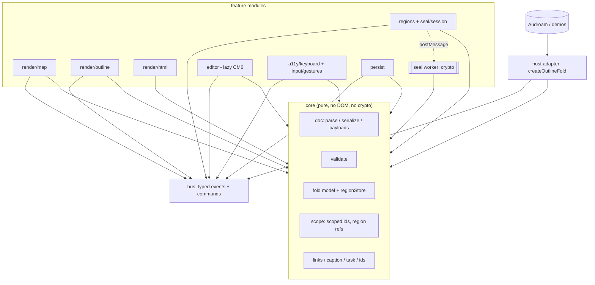

# Spec: outline-fold v1 rebuild (structure, not features)

Status: **draft** · Date: 1 Nov 2026 · Base: `feature/submap-regions-unseal` @ `32d6f8f` (package 0.3.1 + Unreleased P1–P4/R1)

> The brief called the current line 0.2.x. `package.json` is actually at **0.3.1**, with the region/unseal/editor work unreleased on top. Everything here means "0.2.x–0.3.x" when it says "0.x".

## 1. Goals and non-goals

**Goals**
1. Feature parity with 0.x plus the Unreleased branch. No new features. The one exception is the Text-mode fold controls from §3.8, which Colin has already decided.
2. Modular structure. A pure core with no DOM. One typed event and command bus. Renderers, regions/crypto, editor, keyboard/a11y and persistence are separate modules that talk only through the bus and the core model.
3. One host-adapter pattern, so Audroam (and any other host) wires events in one place instead of reaching into `mapView` internals.
4. Split `src/mapView.ts` (6,521 lines, about 34% of `src/`) into the Map renderer plus its gesture, camera, label and region sub-modules.
5. A smaller, intentional public API. Today `src/index.ts` re-exports about 450 symbols, many of them internal constants and helpers.
6. A fast test suite. The default `npm test` runs with no browser, and total suite time must not grow (§5).

**Non-goals**
- No changes to the grammar or file format. `parse`/`serialize` must round-trip every 0.x document byte for byte. `of-seal-v2` stays, and v1 stays decrypt-only.
- No new views, gestures or crypto modes.
- No framework rewrite. The package stays vanilla TS and DOM; React stays an example host only.
- No production MFA. The host still owns key release.

## 2. Feature-parity inventory

Sources: README sections, CHANGELOG, `src/index.ts` exports, and the branch spec `20261101-submap-regions-editor-unseal.md`. Each row gets a v1 module (see §3).

| # | Feature (0.x) | Current files | v1 module |
|---|---|---|---|
| F1 | Grammar v0.2: lean lines, trailer payloads, ids, kinds and flags, tags (`canonTag`/`displayTags`) | parse, serialize, payloads, tagSpelling, types | `core/doc` |
| F2 | Links: `#N` jumps, notes, threads, actions, URL templates, link popover | captionRich, taskChrome, linkTemplates, linkPop | `core/links` + `ui/linkPop` |
| F3 | Rich captions: markdown links, tiny HTML runs, line breaks, tspans | captionRich | `core/caption` |
| F4 | Fold model: `fold-`/`fold+`, `toggleFold`, `setExpandLevel`, fold levels, whole-map levels, count labels | fold, foldLevel, foldLevelMenu (logic) | `core/fold` |
| F5 | Tasks: states, toggling, action firing, task chrome and icons | task, taskChrome, icons | `core/task` + `ui/icons` |
| F6 | Node addressing: persistent ids, `mintNodeId`, auto ids, `cleanIds`/`cleanMarkdown` | nodeAddress, clean | `core/ids` |
| F7 | Validation: `validateDocument`, severities, sealed-branch checks | validate, sealedState | `core/validate` |
| F8 | `toHtml` static render | toHtml | `render/html` |
| F9 | Outline tree: `attachOutlineTree`, keyboard expand level, live announcements | attachOutlineTree | `render/outline` + `a11y` |
| F10 | Map: `createMapView`, auto-pack, scrapbook pack, pills, edges, paint tokens, controls and levels | mapView, mapLabel, svgTextMeasure | `render/map/*` |
| F11 | Map widths: fit/auto/one-line scope, width menu, drag, toasts | mapFit | `render/map/width` (logic in core) |
| F12 | Camera: follow, ensure-visible, fit, easing | mapCamera | `render/map/camera` (pure math) |
| F13 | Gestures: tap/touch guard, swallow, alt-hold menu arbiter (0.2.44), level hold ring, pinch | mapTap, altGesture, mapGesture, foldLevelMenu | `input/gestures` |
| F14 | Node menu: Copy jump, Copy link, focus href (0.2.39) | nodeMenu | `ui/nodeMenu` |
| F15 | Time leaves (0.2.40) | timeLeaf | `render/map/timeLeaf` |
| F16 | Default/cold-start fold seed, lineage height | mapSeed | `core/fold/seed` |
| F17 | Persistence: saved views v2, view prefs, map resume, debounced save, stale check, soft reset | savedView, mapResume | `persist` |
| F18 | Sealed v2: keyring, `sealBranch`/`openSealedBranch`, v1 migration, Argon2 provider, cipher selection, viewers | sealedBranch, sealed, payloads, demoCrypto | `seal` (crypto in a worker) |
| F19 | Seal sessions: state machine, auto-lock, nested "Unlock this branch too?", Remove-seal re-auth | sealSession | `seal/session` |
| F20 | Regions: clouds, `placeRegions`, hulls, mount/unmount, depth cap | mapRegion, regionLayout, mapView | `regions` + `render/map/region` |
| F21 | Scoped ids `regionId:nodeId`, `<r:REGION:N>` resolution | scopedId | `core/scope` |
| F22 | Region fold store, reveal, Outline composition, wipe on lock (R1, FOLD-1..9) | regionFold | `core/fold/regionStore` + `regions` |
| F23 | Host API `on`/`dispatch` | hostApi | `bus` + `host` |
| F24 | Lazy CM6 editor with secure zone (`./editor` export) | editor/, editorLoader | `editor` (lazy) |
| F25 | CSS export `./outline-fold.css` and paint tokens | outline-fold.css | `styles` (same export path) |
| F26 | Keyboard: directional nav, fold keys, focus ownership, selection vs pan | mapView (`mapKeyboard*`, `resolveMapFocus`) | `a11y/keyboard` |
| F27 | Text-mode fold controls (new, decided; see §3.8) | (editor) | `editor/foldGutter` |

**Export inventory.** About 450 named exports from 33 modules. v1 sorts each one into a group:
- **Public**: types, parse/serialize/validate/toHtml, fold ops, ids, the bus, `createOutlineFold`, renderer factories, seal API, persistence API.
- **Advanced**: `@audroam/outline-fold/internals`. These are layout constants (`CHAR_W`, `PILL_PAD_*`, `WIDTH_*`, `VIEW_*`, `ALT_*`, `LEVEL_*`, `TIME_LEAF_*`) and pure helpers that hosts and tests use today.
- **Compat-only**: kept in `@audroam/outline-fold/compat` for 0.x callers (for example `mapPaintShouldRestoreFocus`, `clearSelectionForMapPan`, `swallowConsumes`).

`scripts/export-inventory.mjs` (phase V0) will produce `docs/specs/v1-export-map.json` and fail the build when an export in 0.x has no v1 home.

## 3. Architecture

### 3.1 Layers


### 3.2 Dependency rules (enforced by `scripts/check-deps.mjs` in CI, no test runner needed)
1. `core/**` imports only `core/**`. It does not use DOM globals, `window`, `localStorage`, timers or `crypto`.
2. `bus` imports only `core` types.
3. Feature modules import `core` and `bus`. They never import each other. Map and Outline talk only through bus events and the shared fold store.
4. Only `host` composes modules. Only `host` and `editor/loader` use dynamic `import()`.
5. Crypto lives only in `seal/worker`. The main thread holds no plaintext key material after `lock`. A non-worker fallback (Node and tests) uses the same `SealPort` interface.
6. The editor package is reached only through `import('./editor')`. A static import of CM6 from anywhere else fails the dep check.
7. There are no module-level mutable singletons. Today `sealedBranch` has `setSealCipher`, `setArgon2Provider` and a global key cache. In v1 these move to instance state created by `createSealService()`.

### 3.3 Core
- `Doc` is an immutable tree plus trailers. `parse(text) → Doc` and `serialize(Doc) → text` round-trip.
- `FoldModel` is one store keyed by `ScopedId` (`nodeId` or `regionId:nodeId`, with `regionId` for a region root). Today's per-node `fold` flags and `createRegionFoldStore` merge into this one store. Writing fold state back into `fold-`/`fold+` happens only in `serialize`, and only for the root document. Region and unlocked-sealed state stays memory-only, as now.
- Pure layout math (auto-pack, measure, camera, width, saved-view selection) moves out of the DOM files into `core/layout`, so jsdom tests can import it without a renderer. `svgTextMeasure` sits behind a `Measurer` interface that has a fixed-width implementation for tests.

### 3.4 Bus
`createBus()` replaces `createHostApi`. It keeps the same `on`/`dispatch` shapes and adds the internal events the renderers need, so Build can wire listeners without patching renderers:
```ts
type OFEvent =
 | { type:'unlock'|'lock'|'save'|'change'|'error'; ... }      // 0.x host events, unchanged
 | { type:'select'; id:ScopedId; view:ViewName }
 | { type:'fold'; id:ScopedId; collapsed:boolean; source:ViewName|'host' }
 | { type:'foldLevel'; scope:ScopedId|'all'; level:ExpandLevel }
 | { type:'task'; id:ScopedId; state:TaskState }
 | { type:'link'; id:ScopedId; target:ResolvedRef }
 | { type:'copy'; id:ScopedId; kind:NodeCopyKind }
 | { type:'width'; id:ScopedId; entry:WidthEntry }
 | { type:'view'; view:ViewName; camera?:CamState };
type OFCommand =
 | { cmd:'open'|'lock'|'reveal'|'focus'; ... }                  // 0.x, unchanged
 | { cmd:'fold'; id:ScopedId; collapsed?:boolean }
 | { cmd:'foldLevel'; scope:ScopedId|'all'; level:ExpandLevel }
 | { cmd:'setDoc'; text:string } | { cmd:'save'; region?:RegionId }
 | { cmd:'editor'; open:boolean } | { cmd:'resetView' };
```
- Events are emitted only after a state change has been committed. If a listener throws, the other listeners still run (same as now).
- Each event carries `source`, so views do not echo each other's changes back.

### 3.5 Renderers
- `render/map` is split into `view.ts` (mount, paint), `pill.ts`, `edges.ts`, `camera.ts`, `width.ts`, `timeLeaf.ts`, `region.ts` and `controls.ts`. Each file stays under about 800 lines. A renderer subscribes to `fold`, `select` and `doc` changes and dispatches commands. It never calls host callbacks directly.
- `render/outline` is `attachOutlineTree` rebuilt on the same store and bus.
- `render/html` is the pure `toHtml` string output.

### 3.6 Regions / unseal / crypto
- `seal/service` holds the keyring, cipher choice and Argon2 provider as instance state. The heavy work (KDF, AEAD) runs in a `seal/worker` reached through a `SealPort`.
- `seal/session` is the existing state machine (`sealed → unlocking → unlocked → saving`, `error`). Its transition table becomes data.
- `regions` handles mount/unmount, `placeRegions`, the region `Doc` instances and wipe-on-lock. It is wired to the fold store by subscribing to `lock` (replaces `bindRegionFoldToSessions`).

### 3.7 Editor (lazy)
`editor/` contains the CM6 views, the secure zone and the fold controls. It is loaded only by `dispatch({cmd:'editor', open:true})`. The peer dependencies stay optional.

### 3.8 Text-mode fold controls (decided by Colin, 1 Nov 2026)
- Placement: at the **right end of each line that has children**, never in the left gutter.
- Glyph: **−** when open, **+N** when folded (N = hidden descendant count, same as the Map count chip).
- Visibility: very faint by default (**opacity about 0.25–0.3**). Full opacity on hover or when the cursor is on that line.
- Touch: **30 px** minimum tap target.
- Not selectable (`user-select:none`, CM6 widget decoration outside the text), so copy never includes it.
- Sealed lines end with a faint **🔒** that is **inert**: no click handler, no fold toggle, not focusable, not copied.
- Clicking a control dispatches `{cmd:'fold'}`, which uses the same store and events as Map and Outline.

### 3.9 Keyboard / a11y and persistence
- `a11y` owns focus, roving tabindex, the key maps (fold keys, digits, `*`, Home/End, Esc, directional nav) and the live-region announcements. Each renderer registers a `FocusTarget`.
- `persist` provides `StorageLike` adapters for saved views, view prefs and map resume (v2 keys unchanged). It listens to bus events and writes through a debounce. It does not write to localStorage directly from inside renderers.

## 4. Public API and host adapter
```ts
import { createOutlineFold } from '@audroam/outline-fold';
const of = createOutlineFold({
  text, storage?: StorageLike, seal?: { argon2?, cipher?, port?: SealPort },
  views: { map?: HTMLElement, outline?: HTMLElement, text?: HTMLElement },
  options?: { autoLock?, linkTemplates?, paint?, readOnly? },
});
of.on('save', e => …); of.on('fold', e => …);
await of.dispatch({ cmd:'open', region, passphrase });
of.doc(); of.text(); of.destroy();
```
- Pure entry points stay as named exports: `parse`, `serialize`, `validateDocument`, `toHtml`, fold ops, ids, `scopeId`/`resolveRegionRef`, and all types.
- Renderer factories (`createMapView`, `attachOutlineTree`) stay available for advanced hosts, but they take `{ bus, store }`.
- **One host-adapter pattern.** Each host writes exactly one adapter module that does three things: (a) gets the bus from `createOutlineFold`, (b) maps host events to commands, and (c) maps bus events to host actions such as save, toasts, MFA and navigation. Nothing else in the host imports outline-fold internals.

## 5. Test strategy
- **Default `npm test` = vitest, node environment, core only.** Covers parse/serialize round trips over `examples/` and `tests/vectors`, fold model, scoped ids, validation, the session transition table, layout math, and crypto vectors (with the worker replaced by an in-process port).
- **Renderers in jsdom (`*.dom.test.ts`).** These use the fixed-width `Measurer` with no real layout and no timers (fake timers only), and assert on bus events and DOM structure.
- **Playwright is an optional smoke set** (`npm run test:smoke`) and is not part of `npm test`. It has 6 specs at most: map load and fold, touch tap, alt menu, unlock and cloud (SEAL-2), editor lazy-load and fold controls, Pages viewer. Settings are `timeout: 10_000`, `expect: 3_000`, chromium plus one touch project, `retries: 0`. Today's 25 e2e specs become unit or jsdom tests or are dropped.
- **Runtime budget, checked in CI:** core under 5 s, jsdom under 15 s, smoke under 60 s. Any single test file over 2 s fails a budget check (vitest `--reporter=json` plus a script). The total must not exceed the current suite time, which phase V0 records as the baseline.
- Per the brief, this doc adds no tests. These are plans for the phases below.

## 6. Migration from 0.x
- **Compat shim** `@audroam/outline-fold/compat` re-exports the 0.x names (`createHostApi`, `createMapView(opts)` old signature, `createRegionFoldStore`, `bindRegionFoldToSessions`, `regionOutlineBridge`, the global `setSealCipher`/`setArgon2Provider`, the constants) as thin wrappers over v1. It is shipped in 1.0 and removed in 2.0. Every wrapper logs `console.warn` once in development builds.
- Storage keys, the file format, `of-seal-v2`, CSS class names and paint tokens stay unchanged, so saved views and resume state carry over.
- **Audroam** moves over in three steps:
  1. Add `audroam/src/outlineFoldAdapter.mjs`, the only file that imports `@audroam/outline-fold`. It first wraps the compat API.
  2. Move each hand-wired listener into the adapter as `of.on(...)` / `dispatch(...)`, one feature at a time behind a flag.
  3. Switch the adapter from compat to `createOutlineFold` and delete the legacy mjs wiring and decrypt code (old P6).

## 7. Phases (S = 1–2 days, M = 3–5 days, L = 1–2 weeks)
| Phase | Work | Size |
|---|---|---|
| V0 | Export inventory script, dep-check script, record test-time baseline, mark 0.x export groups | S |
| V1 | `core/` extraction (doc, fold store with scoped ids, scope, validate, layout math, Measurer) behind the current exports | L |
| V2 | `bus` + `createOutlineFold` host adapter; compat `createHostApi` | M |
| V3 | Outline renderer + a11y module on bus/store; jsdom tests | M |
| V4 | Map renderer split (mapView 6.5k lines → about 10 files), gestures/camera/width on bus | L |
| V5 | Seal service instance state + worker port; regions module; wipe-on-lock via bus | M |
| V6 | Editor module on bus + Text-mode fold controls (§3.8) | M |
| V7 | Persistence module; storage adapters | S |
| V8 | Test reshape: unit/jsdom migration, Playwright smoke ≤6, budgets in CI | M |
| V9 | Compat shim finished, Audroam adapter, docs/README, 1.0.0-rc | M |

Total is about 7–9 weeks of focused work. Phases V3–V7 can overlap once V2 has landed.

## 8. Risks and open questions

**Risks**
- Splitting the Map renderer can regress subtle gesture and focus behaviour (two-tap, swallow, alt arbiter). Mitigation: move code without changing behaviour first, and keep the gesture logic pure with table tests.
- Pixel layout could drift when measuring moves behind `Measurer`. Mitigation: golden auto-pack position vectors taken from 0.3.1.
- Worker crypto adds async edges to unlock and save timing, and needs bundler support for workers in Audroam.
- With the Playwright set shrunk, real-browser-only bugs (touch, CSS) can slip through. Mitigation: run the smoke set on release branches.
- Compat wrappers might hide semantics that differ from 0.x (for example, the global seal settings becoming instance state).

**Open questions for Colin**
1. Versioning: is the target **1.0.0** (the brief said 0.2.x, but the repo is at 0.3.1 with unreleased region/unseal work)? Should that Unreleased work ship as 0.4.0 first?
2. Public surface: is it OK to move about 300 constants and helpers to `/internals` and `/compat`, or does Audroam rely on any of them directly?
3. Crypto in a Web Worker: required, or optional with an in-thread fallback as the default?
4. Playwright: which ≤6 smoke flows are must-keep, and should smoke run in CI on every PR or only on release branches?
5. The compat shim's lifetime: one major version (removed in 2.0), or until Audroam has fully moved over?
6. Should `createOutlineFold` own all three views (Map, Outline, Text), or can hosts mount views independently?
7. Text-mode +N: should N count all hidden descendants (as the Map chip does) or only direct children?
8. Are there any 0.x features that can be dropped rather than ported (for example `demoCrypto` in the main entry, the scrapbook pack, or the legacy width-pick kinds)?
