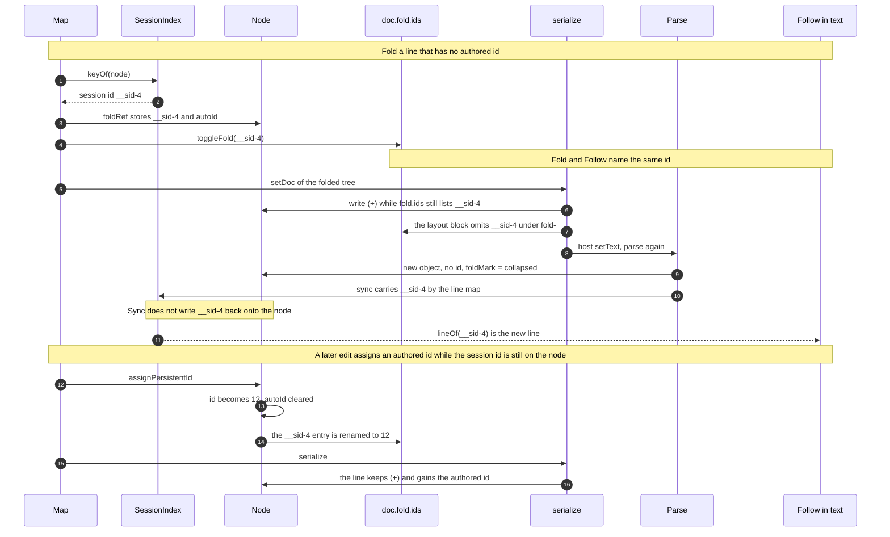

# Working note: node ids and fold state

Checkout `fix/follow-after-fold`, branched from `4a2e754` (v0.7.2).

Two ids. `__sid-N` is the only temporary id. It is the session view key (Map, focus, Follow in text) and, when a line needs a name, `node.id` with `autoId`. Callers that store it are `parse({ sessionIds: true })`, a region row, a zone row, and a fold. The index adopts that string so fold and Follow name one reference. Sync does not write a session id onto a line that does not have one. Serialize does not write `__sid-`. The authored `<id:N>` is the reference that round-trips. When a width, colour, icon, payload, jump, or fold+ entry must survive reload, `assignPersistentId` replaces the session id and renames the fold entry. `__tmp-N` is no longer minted.

